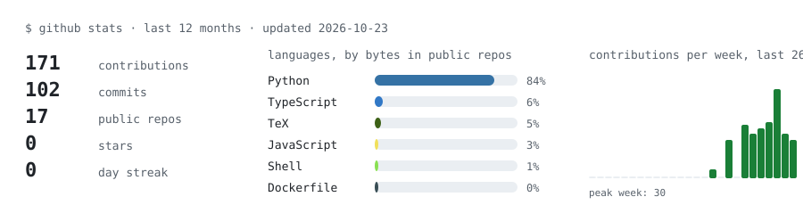

<a href="https://nik-hill-323.github.io/nik-hill-323/#terminal">
<picture>
  <source media="(prefers-color-scheme: dark)" srcset="banner-dark.svg">
  
</picture>
</a>

<b>▶ This page is a snapshot. The live version is interactive:</b> <a href="https://nik-hill-323.github.io/nik-hill-323/#terminal">type in the terminal</a> · <a href="https://nik-hill-323.github.io/nik-hill-323/#retrieval">watch retrieval step by step</a> · <a href="https://nik-hill-323.github.io/nik-hill-323/#game">play the game</a> · <a href="https://nik-hill-323.github.io/nik-hill-323/#map">drag the map</a>

## ask my profile

<picture>
  <source media="(prefers-color-scheme: dark)" srcset="ask-demo-dark.svg">
  
</picture>

Click a question. Each answer is retrieved from a knowledge base of my work and quoted with citations; when nothing supports an answer, it abstains.

<!--faq:start-->

<b>what do you work on right now?</b>

> Since March 2026 he has been an AI Research Engineer at the Center for Global Mental Health Equity (CGMHE) at GWU, building LLM systems for WHO and UNICEF mental health programs. **[1]**

[1] <a href="https://nik-hill-323.github.io/Nikhil_Obuleni/#experience">AI Research Engineer · CGMHE (Mar 2026 – now)</a> · BM25 4.12 · coverage 100%

<b>have you shipped RAG in production?</b>

> He designed a production RAG system (FAISS, LangChain, FastAPI) grounding LLM output in EQUIP/ENACT clinical rubrics, with chunking, reranking, and a hallucination-flagging layer. **[1]**
>
> He shipped an LLM agent pipeline (LangChain, OpenAI API) that automates counselor competency scoring across 26K+ multilingual clinical transcripts in 25 countries. **[1]**

[1] <a href="https://nik-hill-323.github.io/Nikhil_Obuleni/#experience">AI Research Engineer · CGMHE (Mar 2026 – now)</a> · BM25 4.05 · coverage 56%

<b>which languages did the evaluation cover?</b>

> He ran LLM evaluation experiments (RAGAS, DeepEval) comparing GPT-4 and Claude against human-annotated ground truth across 14 languages. **[1]**
>
> The evaluation found a 23% calibration gap on low-resource languages, which fed into a joint OpenAI collaboration on clinical LLM deployment. **[1]**
>
> For RAG infrastructure and evaluation he uses FAISS, Pinecone, Qdrant, pgvector, vLLM, Ollama, RAGAS, DeepEval, LangSmith, and MLflow. **[2]**

[1] <a href="https://nik-hill-323.github.io/Nikhil_Obuleni/#experience">AI Research Engineer · CGMHE (Mar 2026 – now)</a> · [2] <a href="https://nik-hill-323.github.io/Nikhil_Obuleni/#skills">Stack</a> · BM25 3.36 · coverage 100%

<b>have you used Airflow?</b>

> For data engineering he uses SQL, PostgreSQL, MongoDB, Apache Airflow, BigQuery, PySpark, and Pandas. **[1]**
>
> He built Airflow and AWS (S3, EC2) pipelines ingesting 500K+ patient records into PostgreSQL across 25+ countries on a $2.9M NIMH grant. **[2]**

[1] <a href="https://nik-hill-323.github.io/Nikhil_Obuleni/#skills">Stack</a> · [2] <a href="https://nik-hill-323.github.io/Nikhil_Obuleni/#experience">AI Research Engineer · CGMHE (Mar 2026 – now)</a> · BM25 3.51 · coverage 100%

<b>computer vision experience?</b>

> He built computer vision models (YOLOv5, Faster R-CNN) for real-time drone object detection, improving surveillance efficiency 30%. **[1]**

[1] <a href="https://nik-hill-323.github.io/Nikhil_Obuleni/#experience">Data Science Intern · Asteria Aerospace (2023)</a> · BM25 7.85 · coverage 100%

<b>are you open to work?</b>

> He is open to AI engineer and data scientist roles starting January 2027. **[1]**
>
> If you work on AI for health and want a second pair of eyes on an evaluation setup, his inbox is open. **[1]**
>
> ragcheck is the open-source distillation of his clinical LLM evaluation work. **[2]**

[1] <a href="https://www.linkedin.com/in/nikhil-obuleni">Contact & availability</a> · [2] <a href="https://github.com/nik-hill-323/ragcheck">ragcheck</a> · BM25 4.58 · coverage 100%

<b>what's your favorite pizza?</b>

**🤷 Abstained.** None of the words in your question (favorite, pizza) appear in my sources, so I won't guess.

BM25 0 · coverage 0%. A system for clinicians has to be able to say "I don't know".

<!--faq:end-->

<a href="https://github.com/nik-hill-323/nik-hill-323/issues/new?title=ask%3A%20have%20you%20used%20Airflow%3F&body=Replace%20the%20example%20in%20the%20title%20with%20your%20own%20question%20%28keep%20the%20%60ask%3A%60%20prefix%29%2C%20then%20click%20%2A%2ACreate%2A%2A.%20My%20profile%20agent%20answers%20here%20in%20about%2030%20seconds%20with%20citations%2C%20or%20abstains%2C%20then%20closes%20the%20issue.%0A%0A_Only%20the%20title%20is%20read.%20Your%20question%20text%20is%20not%20posted%20on%20my%20profile._"></a>&nbsp; Opens an issue; the same agent answers there in about 30 seconds. Five questions per visitor per day.

<!--asks:start-->
_No questions yet. Be the first._
<!--asks:end-->

## two truths and a hallucination

One of these claims about me is made up, the way an LLM makes things up: a number that drifted, a name that got swapped, a claim turned backwards. Click the one you think is fake to see if you caught it. New round every day.

<!--game:start-->
**Round 2** · started 2026-10-19 · click the claim you think is made up

<b>A</b> · <code>medrag-toolkit</code> falls back to the model's own knowledge when retrieval finds nothing.

🎯 **Caught it. This is the hallucination** (polarity flip). It does the opposite: unsupported sentences are dropped and it abstains rather than guesses. [source](https://github.com/nik-hill-323/medrag-toolkit)

<a href="https://github.com/nik-hill-323/nik-hill-323/issues/new?title=guess%3A+r02+A&body=Click+%2A%2ACreate%2A%2A+to+lock+in+claim+%2A%2AA%2A%2A+as+the+hallucination+in+round+2.+A+GitHub+Action+replies+here+in+about+30+seconds+with+the+answer+and+its+sources%2C+then+closes+the+issue.%0A%0A_Only+the+title+is+read.+Your+first+guess+each+round+counts._">Put A on the leaderboard ↗</a> (opens an issue; a bot checks it and replies)

<b>B</b> · The 14-language evaluation found a 23% calibration gap on low-resource languages.

❌ **Fooled. This one is true.** [source](https://nik-hill-323.github.io/Nikhil_Obuleni/#experience) Open another one.

<a href="https://github.com/nik-hill-323/nik-hill-323/issues/new?title=guess%3A+r02+B&body=Click+%2A%2ACreate%2A%2A+to+lock+in+claim+%2A%2AB%2A%2A+as+the+hallucination+in+round+2.+A+GitHub+Action+replies+here+in+about+30+seconds+with+the+answer+and+its+sources%2C+then+closes+the+issue.%0A%0A_Only+the+title+is+read.+Your+first+guess+each+round+counts._">Put B on the leaderboard ↗</a> (opens an issue; a bot checks it and replies)

<b>C</b> · <code>PlanMoE</code> is a mixture of experts over room-constraint graphs, INT8 quantized, on HF Spaces.

❌ **Fooled. This one is true.** [source](https://github.com/nik-hill-323/planmoe) Open another one.

<a href="https://github.com/nik-hill-323/nik-hill-323/issues/new?title=guess%3A+r02+C&body=Click+%2A%2ACreate%2A%2A+to+lock+in+claim+%2A%2AC%2A%2A+as+the+hallucination+in+round+2.+A+GitHub+Action+replies+here+in+about+30+seconds+with+the+answer+and+its+sources%2C+then+closes+the+issue.%0A%0A_Only+the+title+is+read.+Your+first+guess+each+round+counts._">Put C on the leaderboard ↗</a> (opens an issue; a bot checks it and replies)

No leaderboard guesses yet this round.

Yesterday's answer · round 1

**B** was made up (number drift): _`sepsis-prediction` flags ICU sepsis risk 24 to 48 hours early._  
It flags risk 6 to 12 hours early. [source](https://github.com/nik-hill-323/sepsis-prediction)

<!--game:end-->

<b>Leaderboard</b> · who catches hallucinations best

 

<!--board:start-->
_The board is empty. Catch today's hallucination to get on it._
<!--board:end-->

No model is called: the claim bank is <a href="game/rounds.json"><code>game/rounds.json</code></a> and the judge is <a href="scripts/game.py"><code>scripts/game.py</code></a>. Yes, you can read the answers there. Spotting a hallucination by checking the source is the right instinct.

I build LLM systems for people who cannot afford a wrong answer: clinicians, counselors, and field teams in low-resource settings. Most of my code falls into one of four stages, and I keep a repo for each.

<table>
<tr>
<th align="left" width="25%">retrieve &amp; ground</th>
<th align="left" width="25%">model</th>
<th align="left" width="25%">evaluate</th>
<th align="left" width="25%">decide</th>
</tr>
<tr valign="top">
<td>

**[medrag-toolkit](https://github.com/nik-hill-323/medrag-toolkit)**
Medical question answering over PubMed, OpenFDA and RxNorm. Hybrid dense + BM25 retrieval. Every sentence is checked against its source; anything unsupported is dropped, and it abstains rather than guesses.

</td>
<td>

**[PlanMoE](https://github.com/nik-hill-323/planmoe)** Mixture of experts over room-constraint graphs, INT8 quantized, on HF Spaces.

**[sepsis-prediction](https://github.com/nik-hill-323/sepsis-prediction)** BiLSTM that flags ICU sepsis risk 6 to 12 hours early.

**[skiavox](https://github.com/nik-hill-323/skiavox)** Chest X-ray ensemble with Grad-CAM and DICOM in.

**[mindscope](https://github.com/nik-hill-323/mindscope)** Mental health NLP benchmark, 15+ conditions, BERT and Claude baselines.

</td>
<td>

**[ragcheck](https://github.com/nik-hill-323/ragcheck)**
Scores retrieval, faithfulness, relevance and citation coverage separately, and prints the exact sentences a RAG answer made up. Offline judge for CI, LLM judge for depth, a `gate` command that fails the build.

</td>
<td>

**[abtest-kit](https://github.com/nik-hill-323/abtest-kit)**
Power analysis, z and Welch tests, Bayesian expected loss, always-valid sequential tests, CUPED. Each method is tested against an independent reference. The peeking demo: naive t-test 32% false positives, mSPRT 1.8%.

</td>
</tr>
</table>

## model card

<table>
<tr><td width="24%"><b>model</b></td><td><code>nik-hill-323</code> · AI research engineer · revision <code>2026.10</code></td></tr>
<tr><td><b>intended use</b></td><td>LLM systems where a wrong answer costs something: clinical scoring, counseling quality, humanitarian forecasting.</td></tr>
<tr><td><b>training data</b></td><td>M.S. Data Science, GWU (GPA 3.75, Dec 2026) · CGMHE · Data Science for Sustainable Development · Asteria Aerospace</td></tr>
<tr><td><b>eval results</b></td><td>26K+ transcripts scored in 25 countries · review time 45 min → 4 · factual error rate −40% · 78% weighted F1 on disaster forecasting</td></tr>
<tr><td><b>known biases</b></td><td>Prefers abstaining to guessing. Will ask what your held-out set looks like before writing any code.</td></tr>
<tr><td><b>out of scope</b></td><td>Leaderboard chasing without a held-out set.</td></tr>
<tr><td><b>deployment</b></td><td>Available for January 2027 starts · <a href="mailto:nikhil.obuleni@gwu.edu">nikhil.obuleni@gwu.edu</a></td></tr>
</table>

## log

| when | what |
|---|---|
| **Sep 2026** | Published `ragcheck` and `abtest-kit`. Both green on CI across Python 3.10 to 3.12. |
| **Aug 2026** | `medrag-toolkit` and `PlanMoE` went public. Rebuilt the portfolio site on Next.js. |
| **Mar 2026** | Joined the Center for Global Mental Health Equity at GWU as an AI research engineer. The agent pipeline I shipped scores counselor competency across 26K+ transcripts in 25 countries and cut per-session review from 45 minutes to 4. |
| **2025 – 2026** | ML engineer at Data Science for Sustainable Development: NLP extraction over sustainability reports and ARIMA/LSTM/XGBoost forecasting on 200K+ humanitarian records across 18 countries. |
| **Jan 2025** | Started the M.S. in Data Science at George Washington University. GPA 3.75, finishing Dec 2026. |
| **2023** | Drone object detection and predictive maintenance at Asteria Aerospace, Bangalore. |

## what the evaluation work found

Comparing GPT-4 and Claude against human-annotated ground truth across 14 languages turned up a **23% calibration gap on low-resource languages**. A RAG layer grounded in WHO EQUIP/ENACT rubrics, with reranking and hallucination flagging, brought the factual error rate down by about 40% on held-out multilingual benchmarks. Those findings feed a joint study with OpenAI on clinical LLM deployment. `ragcheck` is the open-source distillation of that measurement work.

## toolbox

Plus the parts without icons: LangChain and LangGraph, the OpenAI and Anthropic APIs, FAISS, Pinecone, Qdrant and pgvector, RAGAS, DeepEval and LangSmith, Hugging Face, spaCy, XGBoost and LightGBM, PySpark, Airflow, BigQuery, MLflow, Streamlit.

## activity

<picture>
  <source media="(prefers-color-scheme: dark)" srcset="stats-dark.svg">
  
</picture>

These cards are rendered by [`scripts/build_stats.py`](scripts/build_stats.py) in this repo, refreshed every morning by a GitHub Action. No third-party widget service.

## elsewhere

[portfolio](https://nik-hill-323.github.io/Nikhil_Obuleni/) · [resume](https://nik-hill-323.github.io/Nikhil_Obuleni/Nikhil_Obuleni_AI_Engineer.pdf) · [linkedin](https://www.linkedin.com/in/nikhil-obuleni) · nikhil.obuleni@gwu.edu

Open now for January 2027 starts, AI engineer and data scientist roles. If you work on AI for health and want a second pair of eyes on an evaluation setup, my inbox is open.
